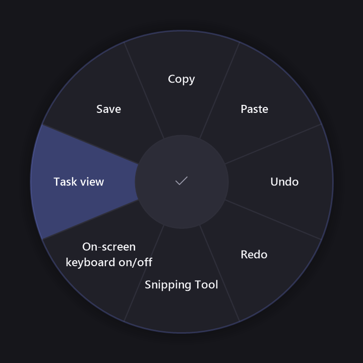
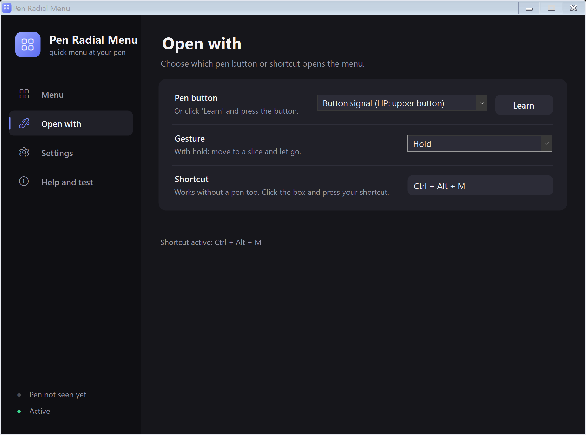

# Pen Radial Menu

**A round quick menu, right at your Windows pen.**
Hold your pen button, move to a slice and let go — or open it with a keyboard shortcut.

🌐 **Website:** https://jillselten.github.io/pen-radial-menu/



## Download

Get **`Pen.Radial.Menu.Setup.exe`** from the [latest release](../../releases/latest) and run it.
No administrator rights needed. Uninstall any time via *Windows Settings → Apps*.

> Windows may show a SmartScreen warning ("unknown publisher") because the app is not code-signed yet.
> Click **More info → Run anyway**.

## Features

- **8 slices of your choice** — 60+ actions, custom shortcuts, typing text, opening programs or websites
- **Open it your way** — pen button with hold, single click or double click, or a shortcut (default **Ctrl+Alt+M**)
- **Works while hovering** — reads the pen directly (HID Raw Input)
- **Learn** — teach it any Windows Ink pen button (MPP, Surface, Wacom AES, USI)
- **Pairs with [Pen Mapper](https://github.com/JillSelten/pen-mapper)** — warns you if both apps use the same button
- **English and Dutch**, dark design, runs in the system tray, optional start with Windows



## Building from source

Only Windows is needed (uses the C# compiler of .NET Framework 4.8):

```powershell
powershell -ExecutionPolicy Bypass -File build.ps1
```

| File | What it is |
| --- | --- |
| `PenRadialMenu.cs` | The app window, pen trigger, shortcut and gestures |
| `Common.cs` | Shared parts: theme, settings, actions, pen input, controls |
| `Radial.cs` | The radial menu |
| `Setup.cs` | The installer |

Also by this maker: [Pen Mapper](https://github.com/JillSelten/pen-mapper) · [Mouse Mapper](https://github.com/JillSelten/mouse-mapper)

---

**Nederlands:** Pen Radial Menu opent een rond snelmenu met 8 acties bij je pen. Houd de pen-knop vast,
beweeg naar een vak en laat los, of gebruik de sneltoets Ctrl+Alt+M. Download `Pen.Radial.Menu.Setup.exe`
bij de [nieuwste release](../../releases/latest).
